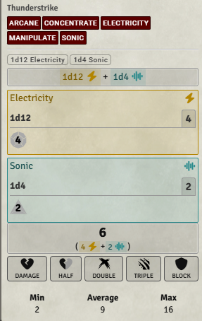
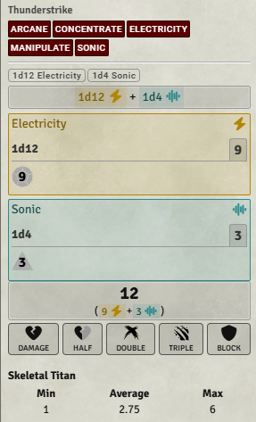
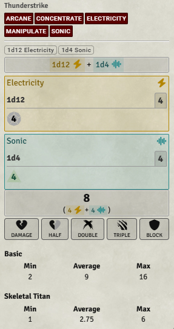
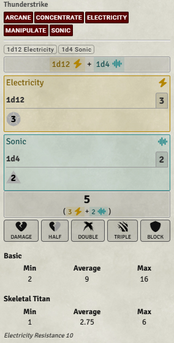
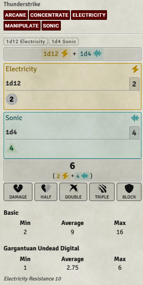
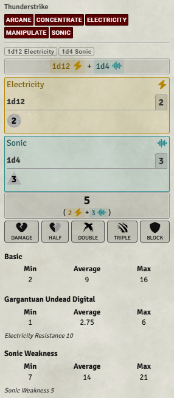

# PF2e Roll Range

A Foundry VTT module for Pathfinder 2e that displays the minimum, average, and maximum possible damage of a damage roll, with optional calculations that account for a target's Immunities, Weaknesses, and Resistances (IWR).

Instead of seeing only the damage you rolled, you can also see the range of possible results.

## Features

- Displays minimum, average, and maximum possible damage.
- Supports damage rolls from player characters and NPCs.
- Calculates statistics for the entire damage roll, including multiple damage types.
- Includes precision and splash damage.
- Excludes persistent damage from the calculations.
- Optionally accounts for target Immunities, Weaknesses, and Resistances (IWR).
- Supports multiple targeted creatures.
- Groups targets with identical damage statistics and applied IWR.
- Displays target names, including mystified names.
- Optionally displays which IWRs were applied (only the applicable ones triggered by the damage roll).
- Displays statistics for public rolls only.

## Screenshots and Examples

### Basic Damage Statistics

The module displays three statistics:

- **Min:** The minimum possible damage.
- **Average:** The expected average damage.
- **Max:** The maximum possible damage.

These statistics are calculated for the complete damage roll rather than separately for each damage type.

### Target IWR Only

When Target IWR Only is selected, the module calculates damage statistics after applying the targeted creature's relevant Immunities, Weaknesses, and Resistances.

For example, a creature with resistance to electricity may receive less damage than the basic damage statistics suggest if your damage roll includes electricity damage.

### Both Basic and Target IWR

You can display both the original damage statistics and the target-adjusted statistics simultaneously.

This makes it easy to compare the damage roll before and after the target's IWR is applied.

### Applied IWR

The Applied IWR Visibility setting determines whether the module displays the specific Immunities, Weaknesses, and Resistances used in its calculations.

Available options:

- **Do Not Display:** Hide the applied IWR descriptions.
- **Display to Everyone:** Show the applied IWR descriptions to everyone who can see the public roll.

### Mystified Creature Names

PF2e Roll Range supports mystified creature names.

When a creature has a mystified name, the module uses that name in the damage statistics instead of intentionally displaying the creature's true identity.

This works with single targets and multiple targets.

### Multiple Targets

The module can calculate target-adjusted damage statistics for multiple selected targets.

Targets with identical damage statistics and applied IWR are grouped together to reduce clutter.

If multiple creatures share the same displayed name, the module can show a count instead of repeating the name.

Creatures whose IWR does not change the basic damage statistics do not receive a separate adjusted entry when both basic and target-adjusted statistics are displayed.

## Installation

### Install Using Foundry VTT

1. Open Foundry VTT.
2. Navigate to **Add-on Modules**.
3. Click **Install Module**.
4. Paste the following URL into the **Manifest URL** field:

   https://raw.githubusercontent.com/MortalxWombat/pf2e-roll-range/main/module.json

5. Click **Install**.
6. Open your Pathfinder 2e world.
7. Enable **PF2e Roll Range** in the module management settings.

### Dependencies

This module requires:

- **lib-item-select-dialog**

Ensure the required dependency is installed and enabled.

## Module Settings

The module provides three settings.

### 1. Damage Range Display

Controls which damage statistics appear in chat.

**Basic Only**

Displays the minimum, average, and maximum possible damage without adjusting for the target's IWR.

**Target IWR Only**

Displays damage statistics adjusted for the targeted creature's relevant Immunities, Weaknesses, and Resistances.

If no valid target is selected, the module displays basic damage statistics.

**Both Basic and Target IWR**

Displays both the basic statistics and the target-adjusted statistics.

This allows users to compare the unadjusted damage range with the range after IWR.

If no valid target is selected, only the basic statistics appear.

### 2. Calculate IWR for Multiple Targets

Controls whether the module calculates target-adjusted statistics when more than one creature is targeted.

**Disabled**

When multiple creatures are targeted, the module displays only basic damage statistics.

**Enabled**

The module calculates target-adjusted statistics for each targeted creature.

Targets with identical statistics and applied IWR are grouped together.

Only unique damage statistics are displayed. Creatures without relevant IWR use the basic statistics and do not receive a separate adjusted entry when both modes are displayed.

### 3. Applied IWR Visibility

Controls whether the specific IWR entries used in the calculations are displayed.

**Do Not Display**

The module does not display the applied IWR descriptions.

**Display to Everyone**

The module displays the applied IWR descriptions to everyone who can see the public roll.  If the target has electricity resistance and fire weakness and you attack with fire damage, the fire weakness will be shown but the electricity resistance will not be shown since it was not triggered.

## Roll Visibility

PF2e Roll Range displays damage statistics only for public rolls.

| Roll Mode | Damage Statistics |
|-----------|-------------------|
| Public Roll | Displayed |
| Private GM Roll | Hidden |
| Blind GM Roll | Hidden |
| Self Roll | Hidden |

The module does not calculate or store new damage-range statistics for nonpublic rolls.

Foundry VTT continues to handle the visibility of the original roll normally.

## Immunities

When a damage component matches a target's immunity, that component contributes no damage to the target-adjusted range.

## Resistances

When a damage component matches a target's resistance, the module reduces the component's damage by the applicable resistance.

Damage cannot be reduced below zero.

The average is calculated using the possible dice outcomes, rather than simply subtracting resistance from the original average.

## Weaknesses

When a damage component triggers a target's weakness, the module adds the applicable weakness value to the adjusted damage statistics.

The module also accounts for weakness entries that apply only once.

## Multiple Damage Types

The module handles damage rolls containing multiple damage types, such as:

- Slashing and fire
- Piercing and precision
- Electricity and sonic

Each nonpersistent damage component is evaluated, and the results are combined into one damage range.

## Persistent Damage

Persistent damage is excluded from the displayed minimum, average, and maximum statistics.

## Compatibility

- **Foundry VTT:** Version 14
- **Pathfinder 2e System:** Version 8.5.1
- **Required Module:** lib-item-select-dialog

## Source Code

GitHub Repository:

https://github.com/MortalxWombat/pf2e-roll-range

## Author

**Mortal Wombat**
